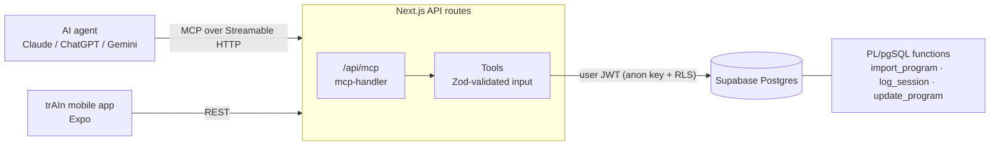

# trAIn-backend

**An MCP server that lets an AI agent (Claude, ChatGPT, Gemini) create, read, adjust and track a user's progressive-overload plan: workouts, reading, studying, running, or any goal you can measure over time.**

Users already ask LLMs for training plans. Then they copy and paste the answer into an app, or lose it in a chat. trAIn skips that step. The agent writes the plan straight into the backend through [Model Context Protocol](https://modelcontextprotocol.io) tools, logs sessions as the user reports them, and edits the plan when the user asks. The backend owns the rules: schema validation, progression logic, concurrency and data isolation. The model doesn't have to get them right.

> Status: active development, running locally. It is the backend of the trAIn mobile app (Expo, separate repo). Hosting target: AWS App Runner + Supabase.

## Example conversation

From the demo recording (Claude Desktop + the trAIn app):

```text
User:  I'd like to work out more, but I only have two 10kg dumbbells at home and
       little time. Can you make me a routine with the train app?
Agent: → import_program
       ✓ "10kg Dumbbell Full Body (Quick)": two 25-minute full-body sessions, 3×/week.
         When you hit 12 reps on every set, the app moves you to a harder
         variation and you start again at 8 reps.

User:  Looks great. How about a routine to read my Rust book as efficiently as possible?
Agent: Which Rust book are you reading? How much time can you give it, and how often?
User:  The Rust Programming Language. 20–30 min, 5×/week.
Agent: → import_program
       ✓ "The Rust Book in 12 Weeks": 4 reading sessions + 1 review session a week,
         4 phases by chapter. You're now using 2 of your 3 program slots.
```

Both plans appear in the app right away, and the user logs a reading session there. One engine handles both: the workout counts reps, the reading plan counts pages.

## Architecture



- **Transport:** `mcp-handler` runs the MCP endpoint as Streamable HTTP inside a Next.js API route. There are no pages or UI.
- **Validation at the edge:** each tool declares a Zod schema, so arguments are checked against JSON Schema before any code runs. We never parse free-form model output.
- **Business rules in the database:** writes that touch more than one row run in Postgres functions inside a single transaction. A bad agent call can't leave a half-written program behind.
- **Least privilege:** the server talks to Postgres with the user's JWT, never the service-role key. Row Level Security on every table scopes every query to `auth.uid()`.

## MCP tools

| Tool | What it does |
| --- | --- |
| `import_program` | Creates a full program (phases → session slots → activities → ladder steps with progression rules) in one transaction. Enforces per-user program slots. |
| `replace_program` | Swaps an existing program for a new one in the same slot. Agents may only call it after `slots_full` and with explicit user consent. |
| `get_program` | Returns a token-cheap **outline** by default. Selectors (`phase_ids`, `session_slot_ids`, `activity_ids`, `activity_label`) return only the parts the agent needs, in full. Also returns the `revision` used for safe edits. |
| `update_program` | Batch edits (up to 500 operations) addressed by id. All-or-nothing, with **optimistic concurrency** via `expected_revision`. |
| `log_session` | Logs one measurement per set, checks each activity's progression rule, and **moves the activity to the next ladder step** when the rule is met. |
| `get_logs` | Session history with every measurement, including history for items later removed from the plan (`removed_from_plan: true`). |
| `ping` | Health check. |

## Engineering highlights

- **Tool descriptions written for agents.** Each description says when to call the tool, what to call first, and what to confirm with the user, e.g. "describe the changes and get agreement before calling it, especially removals." Error codes come back with a recovery hint. `revision_conflict` → "call `get_program` again and rebuild the operations."
- **Context-window aware reads.** `get_program` returns an outline first and full detail only on request, so a 16-week program doesn't use up the agent's context.
- **Atomic, validated plan edits.** `update_program` applies a list of operations in order inside one transaction, then checks invariants on the result: every phase has session slots, every slot has activities, phase weeks don't overlap. If any check fails, nothing is applied.
- **Optimistic concurrency.** Programs have a `revision` that is locked with `SELECT … FOR UPDATE`. A stale agent can't overwrite edits the user made in the app in the meantime.
- **History is never lost.** Removing an activity or step from the plan detaches its logs instead of deleting them, so progress charts stay correct.
- **Domain-agnostic engine.** The model only knows metrics, targets and progression rules (`reps ≥ 12 on all sets → next step, reset to 8`). Push-ups, pages read and minutes run use the same code path.

## Data model

```text
programs ─┬─ phases ── session_slots ── activities ── ladder_steps (target + progression_rule)
          └─ session_logs ── measurement_logs
user_entitlements (program slots) · availability
```

Schema and functions live in [`supabase/migrations/`](supabase/migrations), applied in order.

## Running locally

Requirements: [Bun](https://bun.sh), Docker, and the [Supabase CLI](https://supabase.com/docs/guides/cli).

```bash
bun install
supabase start                 # local Postgres + Auth, applies migrations
bun run dev                    # MCP endpoint at http://localhost:3000/api/mcp
```

`.env.local` needs:

| Variable | Value |
| --- | --- |
| `SUPABASE_URL`, `SUPABASE_ANON_KEY` | `API_URL` and `ANON_KEY` from `supabase status` |
| `MCP_DEV_EMAIL`, `MCP_DEV_PASSWORD` | a user you create in local Supabase Studio (http://localhost:54323). Until OAuth lands, the server acts as this user |

**Try it from an MCP client.** With Claude Code:

```bash
claude mcp add --transport http train-local http://localhost:3000/api/mcp
```

Or use the inspector: `npx @modelcontextprotocol/inspector`.

## Tests

```bash
bun test        # needs `supabase start`
```

Integration tests go through the same path as the MCP server: they call the real Postgres functions on the local stack as signed-in users, using the anon key, so RLS applies. Each test file creates its own throwaway users and deletes them at the end. Covered:

- **`update_program`:** a bad operation rolls back the whole batch, a stale `expected_revision` gets `revision_conflict`, edits that break invariants are refused, removed activities keep their logs.
- **`log_session`:** the progression rule advances the ladder only when every required set meets the target; a retry with the same `client_id` is not logged twice.
- **Isolation:** another user can't read, edit, log against or replace a program; the free slot limit is enforced.
- **Schemas:** the Zod rules agents see before any SQL runs.

## Project structure

```text
app/api/
  route.ts                  health check
  mcp/route.ts              MCP endpoint (mcp-handler)
src/modules/
  mcp/schemas/              Zod schemas for programs and update operations
  mcp/tools/                one file per MCP tool
  supabase/client.ts        per-user Supabase client
supabase/migrations/        schema, RLS policies, PL/pgSQL functions
tests/                      integration tests (bun test + local Supabase)
```

## Roadmap

- [x] Data model + RLS
- [x] MCP tools: import, get, replace, update, log, logs
- [x] Progression engine (automatic ladder advancement)
- [ ] OAuth 2.1 for remote MCP clients (Supabase Auth as authorization server). Local dev currently signs in as a fixed dev user
- [ ] `get_adherence`, `set_availability`
- [ ] REST endpoints for the mobile app
- [x] Integration tests for the Postgres functions
- [ ] CI running the test suite against a fresh Supabase stack
- [ ] Deploy to AWS App Runner

## Stack

TypeScript · Next.js 16 (API routes only) · MCP TypeScript SDK + `mcp-handler` · Zod 4 · Supabase (Postgres, Auth, RLS) · PL/pgSQL · Bun

## License

[MIT](LICENSE)
